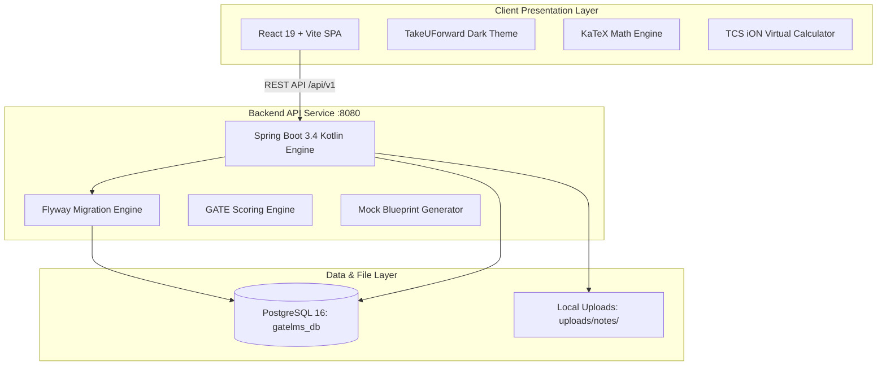

# SPEC.md — GateLMS Master Architecture & Specification

## 1. Executive Summary & Goal
**GateLMS** is a high-performance, single-portal Learning Management System built specifically for the **GATE 2028 Computer Science & Information Technology (CS)** examination.

The system consolidates five disparate preparation streams into one unified dashboard:
1. **Weighted Syllabus Hierarchy** (10 subject clusters, textbook cross-references).
2. **2,500+ Question Bank** (GATE Overflow PYQs with two-pass tracking: learning vs unassisted speed).
3. **Categorized Mistake Notebook** (Root-cause classification: NAT slips, MSQ traps, conceptual holes, question misreads).
4. **TCS iON Center Mock Simulator** (65 questions, 180 minutes, exact 5-state palette, embedded virtual calculator).
5. **iPad Notes & Study Vault** (Permanent PDF uploads from GoodNotes/Notability/Apple Notes mapped to topics).

---

## 2. Technology Stack & Topology

| Layer | Technology | Rationale |
| :--- | :--- | :--- |
| **Database** | PostgreSQL 16 (Docker / Local) | Native `JSONB` for exam blueprints, full-text search (`tsvector`), Flyway migrations. |
| **Backend** | Spring Boot 3.4+ (Kotlin, JVM 21, Maven) | High performance, zero boilerplate with Kotlin `data class`, compile-time null safety. |
| **Frontend** | Vite 8 + React 19 + TypeScript | Instant HMR, zero SSR hydration overhead, fast PWA for iPad browser. |
| **Styling & UI**| Tailwind CSS + TakeUForward Tokens | Deep dark aesthetic (`#0d0d0d`), Lucide React icons, Recharts analytics, KaTeX math. |
| **Infrastructure**| Docker Compose | Containerized PostgreSQL store with automated database initialization. |

---

## 3. Database Schema (Flyway V1 Migration Blueprint)

### 3.1 Tables Overview
1. `subjects`: Top-level GATE subject clusters (e.g. Discrete Math, Operating Systems).
2. `topics`: Atomic topics under each subject with textbook references (e.g. Rosen §1.3, Galvin §5).
3. `questions`: 2,500+ PYQ question bank (MCQ, MSQ, NAT) with statements, options, keys, and tolerance.
4. `mock_exams`: Exam templates and configured mock tests (GA 10Q + CS 55Q).
5. `mock_attempts`: Candidate attempts with timestamps, total scores, and positive/negative mark breakdown.
6. `attempt_answers`: Per-question state (5-state TCS iON: Not Visited, Not Answered, Answered, Marked for Review, Answered & Marked).
7. `mistake_logs`: Root-cause tagged errors with mandatory 1-line corrective takeaway rules.
8. `notes`: Uploaded iPad PDF notes tagged by subject/topic.

---

## 4. The 5 Core Feature Modules

### Module 1: Syllabus & Weighted Mastery Graph
- **Weighted Formula**:
  $$\text{Syllabus Mastery \%} = \sum (\text{Topic Mastery} \times \text{Subject Weightage Factor})$$
- Direct mappings to standard reference textbooks:
  - Discrete Mathematics: Kenneth Rosen
  - Algorithms: Cormen, Leiserson, Rivest, Stein (CLRS)
  - Operating Systems: Silberschatz, Galvin, Gagne
  - Theory of Computation: Michael Sipser
  - Computer Networks: Kurose & Ross / Forouzan
  - Databases: Silberschatz (Database System Concepts)
  - COA: Carl Hamacher / Patterson & Hennessy

### Module 2: Question Bank & 2-Pass PYQ Engine
- **Question Types**:
  - `MCQ`: Single choice with options A, B, C, D.
  - `MSQ`: Multi-select; all correct options required. Zero partial marks. Zero negative marks.
  - `NAT`: Numerical answer with tolerance range $[\text{minVal}, \text{maxVal}]$. Zero negative marks.
- **Two-Pass System**:
  - `Pass 1`: Learning phase (assisted, unassisted, or failed).
  - `Pass 2`: Speed phase (target: unassisted under 3 minutes).

### Module 3: Categorized Mistake Notebook
- Every wrong question requires tagging with one of four root causes:
  1. `CONCEPTUAL`: Unknown axiom, theorem, or systems mechanism.
  2. `CALCULATION`: Arithmetic slip or virtual calculator entry error.
  3. `MSQ_TRAP`: Missed edge condition (e.g. empty set $\emptyset$, epsilon $\epsilon$).
  4. `MISREAD`: Overlooked negation ("NOT", "FALSE", 0-indexed vs 1-indexed).
- Mandatory `corrective_takeaway` rule to reinforce retention.

### Module 4: TCS iON Center Mock Engine
- **Exam Topology**:
  - 65 Questions | 100 Marks | 180 Minutes
  - Section A: General Aptitude (5 × 1M + 5 × 2M = 15 Marks)
  - Section B: Computer Science (25 × 1M + 30 × 2M = 85 Marks)
- **Palette States**:
  1. `NOT_VISITED` (Gray)
  2. `NOT_ANSWERED` (Red)
  3. `ANSWERED` (Green)
  4. `MARKED_FOR_REVIEW` (Purple)
  5. `ANSWERED_AND_MARKED_FOR_REVIEW` (Purple + Green Dot - evaluated for score)
- **Virtual Calculator**: Exact on-screen clone of GATE Scientific Calculator.

### Module 5: iPad Notes & Storage
- Upload handwritten PDF exports from iPad (GoodNotes, Notability, Apple Notes).
- Stored permanently in local `uploads/notes/` directory.
- Mapped to topics and questions for instant cross-referencing.

---

## 5. Development Phases & Milestones

- **Phase 0: Scaffold & Foundation** (Docker Postgres + Spring Boot Kotlin + React Vite Setup + Initial Migrations)
- **Phase 1: Syllabus Taxonomy & Question Bank Core** (Seed 10 subjects + Question CRUD + LaTeX renderer)
- **Phase 2: TakeUForward Dashboard & Mastery Visualizer** (Sidebar + Circular Progress + Subject Cards)
- **Phase 3: TCS iON Exam Engine & Scoring** (Palette + 3-Hour Timer + Virtual Calc + Scoring tests)
- **Phase 4: Mistake Notebook & Spaced Repetition Queue** (4-category error tagger + due revision tracker)
- **Phase 5: iPad Notes Vault & Polish** (PDF viewer + export + hard feature freeze)
